# DR-CPanel

   

Menu-driven **port-forward tunnel manager** (iptables DNAT) with a built-in **galaxy-styled web panel** — one script for **both servers**: the Iran side opens the ports, and the same script on the foreign (kharej) server joins a tunnel with one link (`dr-cpanel join '<link>'`).

## Screenshots

| Dashboard | Tunnels | User quota |
|---|---|---|
| 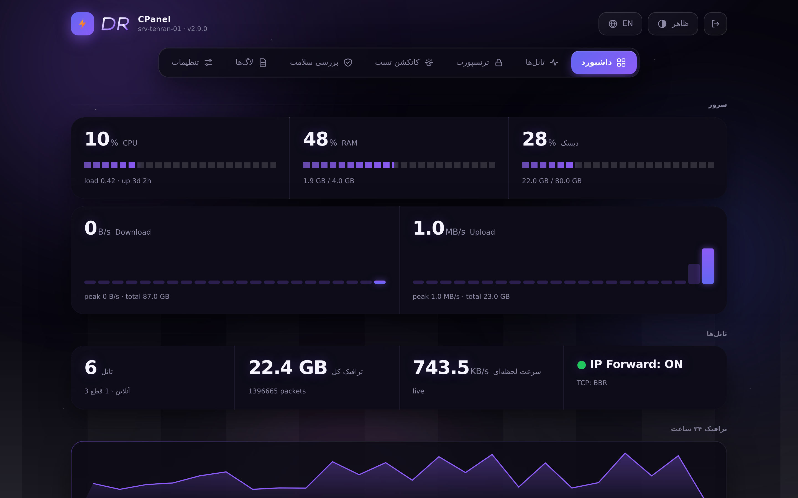 | 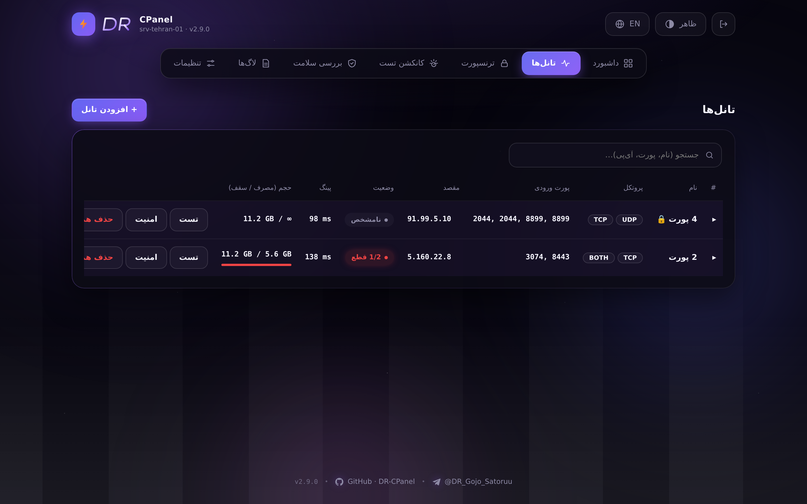 | 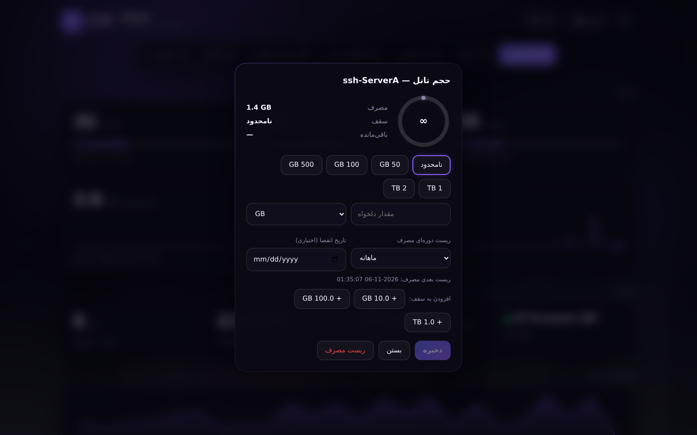 |
| **Login** | **Light theme (EN)** | **User usage page** |
| 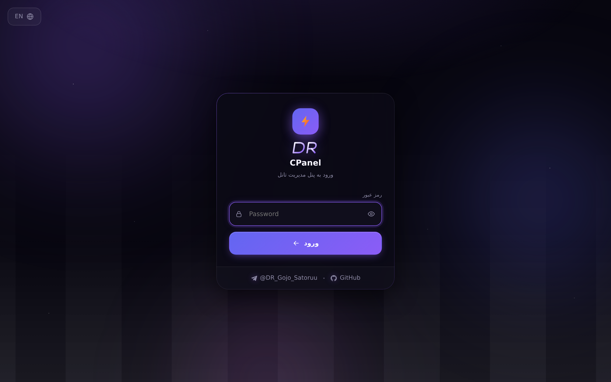 | 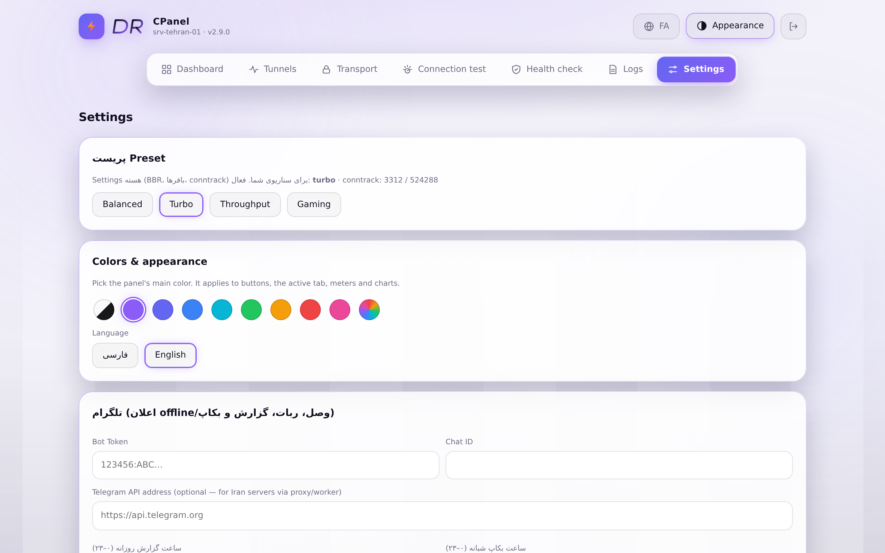 | 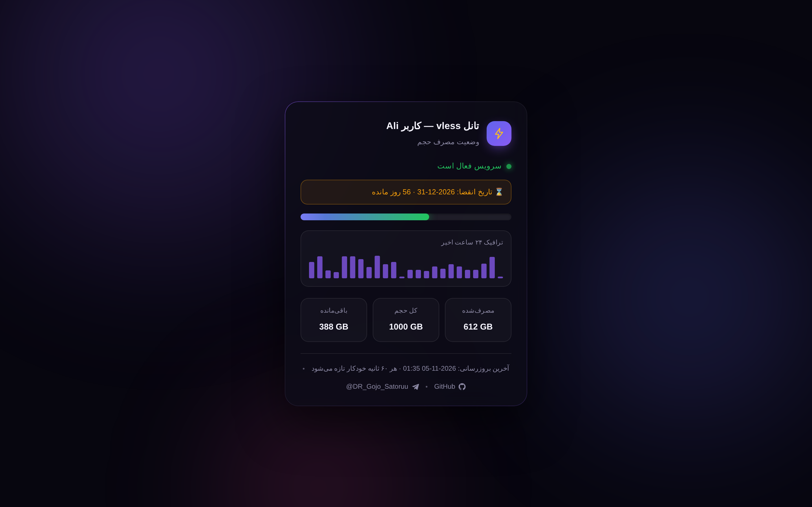 |
| **Tunnel wizard (v2.9)** | **Connection test (v2.9)** | **Join one-liner (v2.9)** |
| 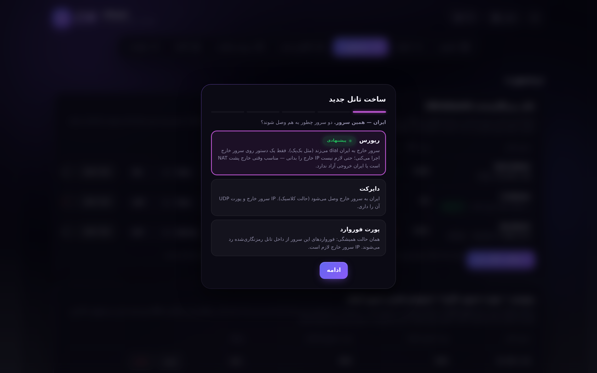 | 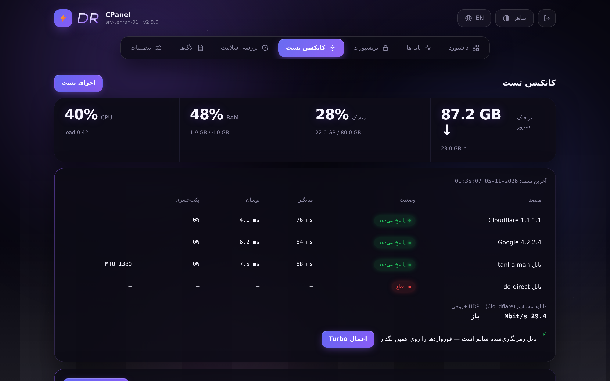 | 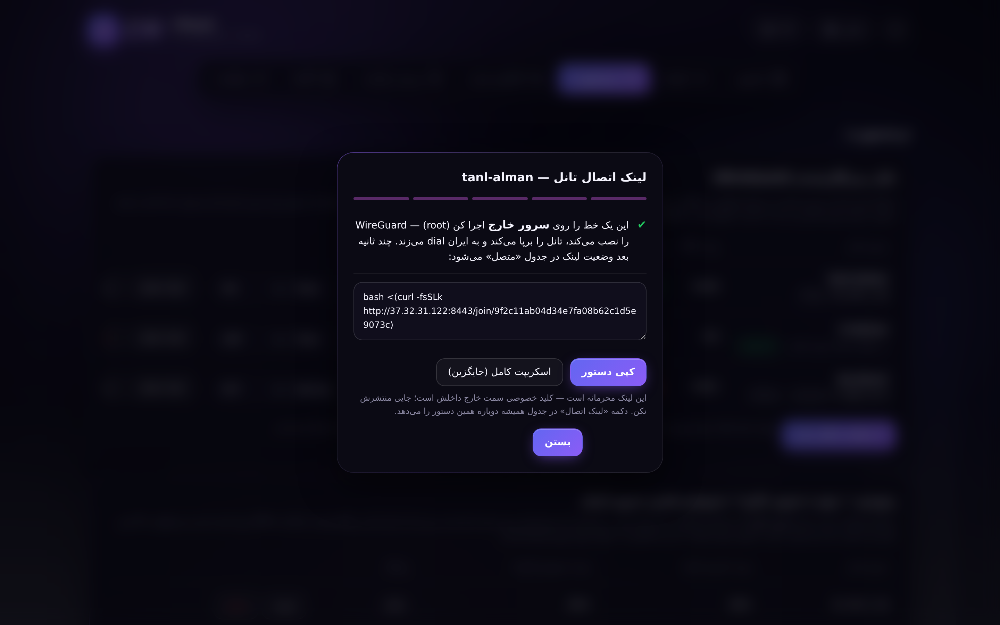 |
| **Wizard transport choice (v2.9)** | **Two-server test (v2.9)** | **Reverse forwards + Link Test (v2.9)** |
| 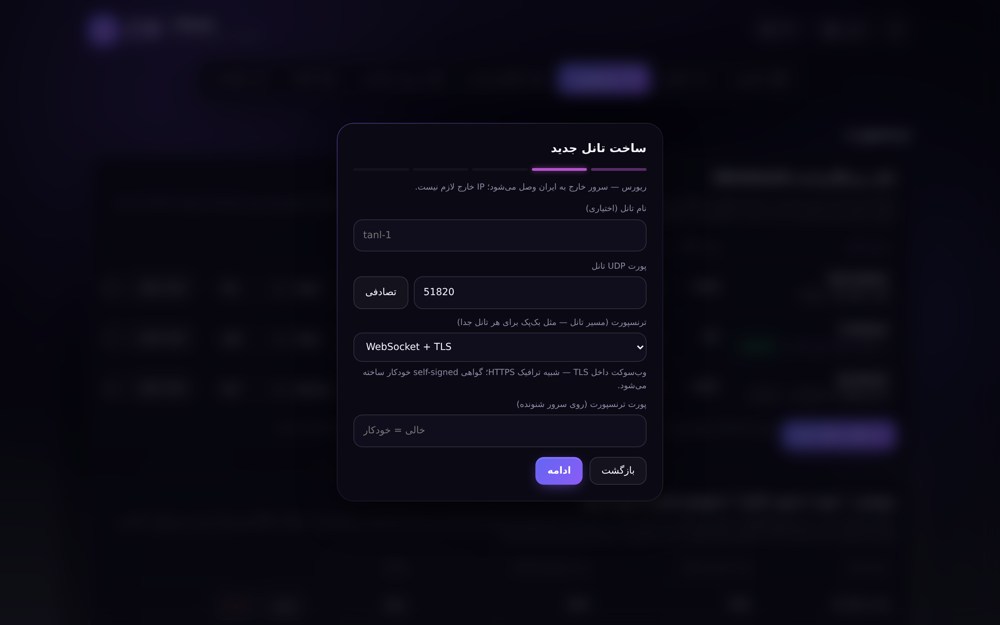 | 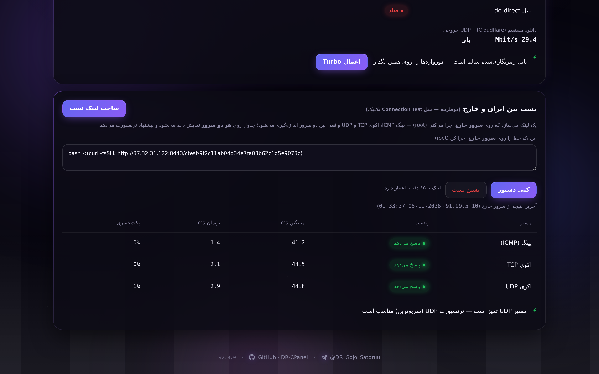 | 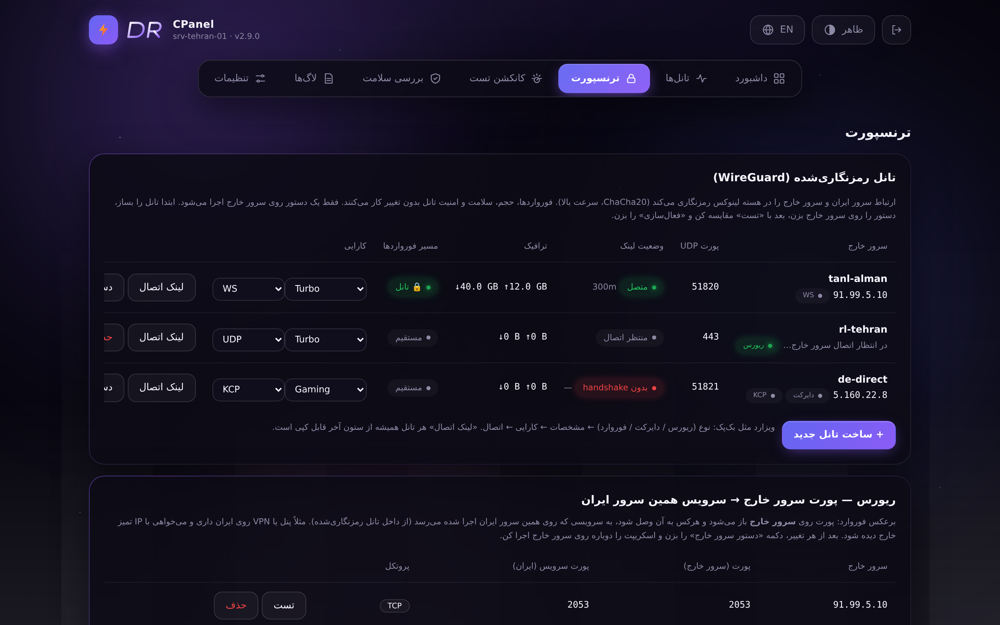 |

## Install

```bash
bash <(curl -fsSL https://raw.githubusercontent.com/behymin12345-hash/DR-CPanel/main/install.sh)
```

Run as **root**. After installing, open the menu any time with:

```bash
dr-cpanel
```

**Setting up the foreign (kharej) server?** Install the same way and run `dr-cpanel join '<link>'` — or do it in one shot:

```bash
bash <(curl -fsSL https://raw.githubusercontent.com/behymin12345-hash/DR-CPanel/main/install.sh) join '<https://IRAN_IP:8443/join/<token>>'
```

## Features

### Tunnels & forwarding
- Add / list / remove port forwards (TCP, UDP or both), **several listen ports at once** (`8899,2044`)
- **BackPack-style tunnel wizard (new in v2.9)** — “+ New tunnel” opens a 5-step wizard: **Type → Tunnel → Performance → Optional → Done**. Type: **Reverse** (the foreign server dials in to Iran — no foreign IP needed at all), **Direct** (Iran dials out to the foreign server) or **Port forward** (the classic mode you already have). The performance preset is picked inside the wizard and stored **per tunnel**
- **6 transports per tunnel, BackPack-style (new in v2.9)** — every tunnel picks how it crosses the Iran ⇄ abroad path: **UDP** (plain WireGuard, fastest), **TCP**, **WebSocket (WS)**, **WebSocket + TLS (WSS)**, **UDP + KCP** (error correction for lossy paths) or **QUIC**. You pick it in the wizard (or switch any time from the tunnel table / `dr-cpanel tunnel transport IP tcp`); the carrier is [gost v3](https://github.com/go-gost/gost), installed automatically with SHA-256 verification and bundled into the offline package
- **Two-server connection test (new in v2.9)** — like BackPack's Connection Test: the panel builds a **test link**; running it on the **kharej** measures real **ICMP ping, TCP-echo and UDP-echo** between the two servers, prints the table **on both sides** and **recommends a transport** (UDP clean → UDP, lossy → KCP, UDP blocked → TCP/WS) with one-click apply
- **Setup Kharej in the same script (new in v2.9)** — run `dr-cpanel` on the foreign server and pick **13) Setup Kharej**, or `dr-cpanel join '<link>'`, or one command straight from the installer: `bash <(curl -fsSL .../install.sh) join '<link>'` — everything (both roles) lives in this one script
- **Join one-liner (new in v2.9)** — like BackPack, after creating a tunnel the panel gives you **one command** (`bash <(curl -fsSL …/join/<token>)`); paste it on the **foreign (kharej) server** as root and the tunnel comes up by itself: it installs WireGuard, writes the config and dials back to Iran. The link stays copyable forever from the tunnel table ("Join link" button) and works behind NAT (reverse mode keeps a persistent keepalive). Each tunnel can also get the classic full script instead
- **Reverse forwards (new in v2.9)** — a port opens on the **foreign server** and lands on a service of the **Iran server** through the encrypted tunnel: publish your Iran-hosted panel/VPN on the foreign server's clean IP. Both directions in one panel, each entry testable with one click (12-probe loop test)
- **Multiple foreign servers with grouping** — organize tunnels per node
- **WireGuard encrypted transport** between Iran and each foreign node (`10.66.x.x` link, keys generated automatically) + a script for the foreign side
- **Auto MTU** — the largest packet the link really passes is measured with DF pings and applied automatically (`tunnel mtu` or on first activation)
- **Tunnel watchdog** — every 15 s: detects a dead link, restarts the WireGuard interface, reports exact downtime and **auto-heals after the foreign server reboots**
- **Link Test (new in v2.9)** — BackPack-style transport test: 12 TCP probes direct vs tunnel (latency, min/max, jitter, loss), a **UDP egress check** (the WireGuard tunnel rides on UDP — if UDP is blocked it tells you right away) and a **preset recommendation** with one-click apply + **iperf3 bandwidth test** through the tunnel (Mbps / jitter / loss)
- **Connection-test page (new in v2.9)** — a BackPack-style dashboard: CPU / RAM / disk / traffic cells, then one full test (about 20 s): ICMP latency + jitter + loss to Cloudflare and Google, real **download speed** (Cloudflare), **UDP egress**, a health check of every encrypted tunnel with its **MTU probe** — and a recommendation banner (best method + suggested preset, one click to apply). Also available from the terminal: `dr-cpanel conntest`
- Live traffic counters for every forward
- Connection test (TCP connect time and ping to the foreign node)

### Quotas & users
- Per-forward **traffic quota** (the port is cut automatically when the quota is reached)
- **Periodic quotas** — usage resets automatically every day / week / month
- **Expiry dates** — give every forward an end date; it is cut off automatically and the user page shows the days remaining
- **User usage link** (`/sub/<token>`) so each user can see their own usage — with its own styled page, **24 h usage chart and expiry countdown**
- Import hand-made iptables rules into the panel

### Performance
- **4 performance presets** (menu 5 or one click in the panel): `Balanced`, `Turbo`, `Throughput` (64 MB buffers, 1 M conntrack), `Gaming` (busy-poll, short timeouts) — each applies BBR + tuned buffers + conntrack limits and survives reboots
- **Per-tunnel preset (new in v2.9)** — like BackPack, every tunnel stores its own preset: you pick it when creating the tunnel, can change it any time from the tunnel table (or `dr-cpanel tunnel preset IP NAME`), and it is applied automatically whenever that tunnel is activated
- Conntrack monitor in the health check

### Security
- Per-tunnel **allowed IPs** (comma separated, CIDR supported)
- **Max simultaneous connections per IP** and **max new connections per minute per IP**
- **TOTP two-step login** (Google Authenticator / Aegis compatible, stdlib implementation) + 8 one-time **recovery codes**
- **Audit log** — every login, rule change, quota change, tunnel action and setting is recorded (panel → Logs → Audit, or `dr-cpanel audit`)

### Telegram
- Alerts: forward up/down, tunnel down/up with downtime, quota reached, expiry, high resources
- **Bot commands** — `/status`, `/tunnels`, `/traffic`, `/report` right from your Telegram chat
- **Daily report** at a configurable hour
- **Nightly backup** sent to Telegram automatically
- Works through a Bot API proxy/worker for Iran servers

### Web panel (v2.8 galaxy UI)
- Galaxy neon lighting: aurora glow, starfield background, glass cards with gradient borders
- **Dark + light themes**, **8 accent colors + custom color picker**
- **FA / EN** language switch, fully **responsive on mobile**
- Sliding tab indicator, animated number counters, boot loading screen
- **Tunnel search** (name / port / IP) and **click-to-copy** destination
- **24-hour traffic chart** on the dashboard
- Per-port security editor, quota management with period + expiry, live meters
- Domain + HTTPS (Let's Encrypt) or self-signed certificate
- GitHub & Telegram links in the footer

### System
- Starts automatically after reboot (systemd, both tunnels and web panel)
- Backup & restore of all settings
- **Offline package** with SHA256 checksums — for servers that cannot reach GitHub (`dr-cpanel package` or the button in the panel)
- **Rollback** — the previous version is kept on every update: `dr-cpanel rollback`
- Clean uninstall
- Self-update: `dr-cpanel update`

## Requirements

- Linux with `iptables` (installed automatically if missing: Ubuntu / Debian / CentOS / Rocky / Alma)
- `python3` for the web panel (installed automatically if missing)
- Root access
- If `ufw` is active, allow each listen port: `ufw allow <port>/tcp`

## Commands

| Command | What it does |
|---|---|
| `dr-cpanel` | Open the interactive menu |
| `dr-cpanel apply` | Re-apply all saved forwards (used by systemd at boot) |
| `dr-cpanel list` | Show all forwards with live counters |
| `dr-cpanel tunnel add IP [UDP_PORT] [MTU] [PRESET]` | Add a foreign node (WireGuard link) — MTU 0 = auto, preset = this tunnel's performance profile |
| `dr-cpanel tunnel join-open [UDP_PORT] [PRESET] [NAME]` | Create a **reverse** tunnel with no foreign IP: it prints a join token; the panel turns it into the one-line link for the foreign server |
| `dr-cpanel tunnel transport IP [udp\|tcp\|ws\|wss\|kcp\|quic] [CPORT]` | Read / switch a tunnel's transport (the foreign script must run again after a carried switch) |
| `dr-cpanel join '<link>'` | **Run on the foreign server**: fetch the join script from the Iran panel and bring the tunnel up |
| `dr-cpanel kharej` | Foreign-side status: every `drwg*` link and its handshake age |
| `dr-cpanel tunnel link IP-or-ID` | Print (or rotate) the join token of a tunnel |
| `dr-cpanel conntest` | BackPack-style connection test in the terminal: ping/jitter/loss, Cloudflare download speed, UDP egress, per-tunnel health + MTU and a preset recommendation |
| `dr-cpanel tunnel script IP` | Print the setup script for the foreign node |
| `dr-cpanel tunnel use IP` / `direct IP` | Route traffic through the tunnel / directly |
| `dr-cpanel tunnel mtu IP` | Measure and apply the best MTU for the link |
| `dr-cpanel tunnel preset IP [NAME]` | Read / set the per-tunnel performance preset (`none` = follow the system preset) |
| `dr-cpanel reverse add IP LPORT DPORT [proto]` | Reverse forward: open `LPORT` on the foreign server, land on service port `DPORT` of this (Iran) server |
| `dr-cpanel reverse del IP LPORT` / `reverse list` | Remove / list reverse forwards (re-run the foreign script after every change) |
| `dr-cpanel reverse test IP LPORT` | 12-probe test of the whole reverse loop (foreign DNAT → tunnel → Iran service) |
| `dr-cpanel tunnel sync` | Sync all WireGuard links |
| `dr-cpanel tunnel del IP` | Remove a foreign node |
| `dr-cpanel perf NAME` | Apply a performance preset: `balanced` / `turbo` / `throughput` / `gaming` |
| `dr-cpanel audit [N]` | Show the last N audit-log entries |
| `dr-cpanel package` | Build an offline install package with SHA256 checksums |
| `dr-cpanel rollback` | Restore the previous version (kept on every update) |
| `dr-cpanel update` | Update to the latest version (settings kept) |

## Web panel

Open from the menu: **9) Web panel → 1) Install / update**

- Default port: `8443` (you choose it on first install), default URL: `https://SERVER_IP:8443`
- A random admin password is generated on first install (shown once, changeable from the menu)
- HTTPS uses a self-signed certificate by default → the browser warns **once**, choose *Advanced → Proceed*
- For a trusted certificate: **9) Web panel → 7) Domain + HTTPS (Let's Encrypt)** (the domain's A record must point to this server)
- Panel settings are stored in `/etc/dr-cpanel` together with everything else

## Update

```bash
dr-cpanel update
```

or run the install command again. **All forwards, tunnels, quotas and settings in `/etc/dr-cpanel` are kept** — the update only replaces the program and the web panel files.

If anything goes wrong:

```bash
dr-cpanel rollback    # go back to the previous version
```

### 2FA (two-step login)

Settings → **ورود دومرحله‌ای (TOTP)** → *فعال‌سازی* → scan the secret with Google Authenticator / Aegis → confirm with a 6-digit code → **save the 8 recovery codes**. From then on, signing in asks for password + code (a recovery code works too, once each).

### Telegram bot

Settings → Telegram → save **Bot Token + Chat ID** (send `/start` to your bot first). Then:

| Command | Reply |
|---|---|
| `/status` | forwards online/offline, CPU / RAM, congestion control |
| `/tunnels` | WireGuard links with status and traffic |
| `/traffic` | last-24 h traffic + top 5 forwards |
| `/report` | the full daily report |

Daily report hour and nightly backup hour are configurable in the panel. On an Iran server that cannot reach api.telegram.org, put a Bot-API-compatible worker/proxy URL in the API field.

## Uninstall

Menu → **10) Uninstall**

## Contact

Telegram: [@DR_Gojo_Satoruu](https://t.me/DR_Gojo_Satoruu)
GitHub: [behymin12345-hash/DR-CPanel](https://github.com/behymin12345-hash/DR-CPanel)

## License

MIT

---

# راهنمای فارسی

**DR-CPanel** یک مدیر تونل پورت‌فوروارد (با iptables) همراه با منوی ترمینال و **پنل وب با تم کهکشانی** است.
روی **سرور ایران** نصب می‌شود. کاربرها به آن وصل می‌شوند و ترافیک به سرور خارج فوروارد می‌شود. روی سرور خارج هیچ چیزی لازم نیست.

## نصب

با کاربر root این دستور را بزن:

```bash
bash <(curl -fsSL https://raw.githubusercontent.com/behymin12345-hash/DR-CPanel/main/install.sh)
```

بعد از نصب، هر وقت خواستی منو را باز کنی فقط بنویس: `dr-cpanel`

## قابلیت‌ها

### تونل و فوروارد
- افزودن، نمایش و حذف فوروارد (TCP / UDP / هر دو) با **چند پورت هم‌زمان** (`8899,2044`)
- **چند سرور خارج با گروه‌بندی** — تونل‌ها را بر اساس نود سازمان‌دهی کن
- **فوروارد ریورس (جدید در 2.9)** — پورت روی **سرور خارج** باز می‌شود و به سرویسی روی همین **سرور ایران** می‌رسد (از داخل تونل رمزنگاری‌شده): پنل یا VPN ایرانت را با IP تمیز سرور خارج منتشر کن. هر دو جهت توی یک پنل، با تست تک‌کلیکی ۱۲ پروبی برای هر ردیف
- **ترنسپورت رمزنگاری‌شده WireGuard** بین ایران و هر سرور خارج (لینک `10.66.x.x`، ساخت خودکار کلیدها) به‌همراه اسکریپت آماده برای سمت خارج
- **MTU خودکار** — بزرگ‌ترین بسته‌ای که لینک واقعاً رد می‌کند با پینگ DF اندازه‌گیری و خودکار اعمال می‌شود (`tunnel mtu` یا موقع اولین فعال‌سازی)
- **Watchdog تونل** — هر ۱۵ ثانیه: قطعی لینک را تشخیص می‌دهد، اینترفیس WireGuard را ری‌استارت می‌کند، مدت دقیق قطعی را گزارش می‌کند و بعد از ریبوت سرور خارج **خودش همه‌چیز را ترمیم می‌کند**
- **تست لینک (جدید در 2.9)** — تست ترنسپورت به سبک BackPack: ۱۲ پروب TCP مقایسه‌ی مستقیم و تونل (تأخیر، کمترین/بیشترین، نوسان، افت بسته)، **بررسی خروجی UDP** (تونل WireGuard روی UDP سوار است — اگر UDP بسته باشد همان‌جا می‌گوید) و **پیشنهاد پریست کارایی** با اعمال تک‌کلیکی + **تست پهنای باند iperf3** از داخل تونل (Mbps / نوسان / افت — اسکریپت سمت خارج سرویس iperf3 را خودکار نصب می‌کند)
- شمارنده‌ی ترافیک زنده برای هر فوروارد
- تست اتصال (زمان اتصال TCP و پینگ به سرور خارج)

### کوتا و کاربران
- **محدودیت حجم** برای هر فوروارد (با رسیدن به سقف، پورت خودکار قطع می‌شود)
- **کوتای دوره‌ای** — مصرف هر روز / هفته / ماه خودکار صفر می‌شود
- **تاریخ انقضا** — برای هر فوروارد تاریخ پایان بگذار؛ خودکار قطع می‌شود و صفحه‌ی کاربر روزهای باقی‌مانده را نشان می‌دهد
- **لینک مصرف کاربر** (`/sub/<token>`) — با صفحه‌ی اختصاصی، **نمودار مصرف ۲۴ ساعت و شمارش معکوس انقضا**
- وارد کردن رول‌های دستی iptables به پنل

### کارایی
- **پریست کارایی هر تونل (جدید در 2.9)** — مثل BackPack هر تونل پریست خودش را دارد: موقع ساخت تونل می‌پرسد، هر وقت خواستی از جدول تونل‌ها تغییرش بده (یا `dr-cpanel tunnel preset IP NAME`) و با فعال‌شدن هر تونل، پریست خودش خودکار اعمال می‌شود
- **۴ پریست کارایی** (منوی ۵ یا یک کلیک توی پنل): `Balanced`، `Turbo`، `Throughput` (بافر ۶۴MB، conntrack یک‌میلیون)، `Gaming` (busy-poll و تایم‌اوت کوتاه) — هر کدام BBR + بافر تنظیم‌شده + سقف conntrack را اعمال می‌کنند و بعد از ریبوت می‌مانند
- مانیتور conntrack در بررسی سلامت

### امنیت
- **IPهای مجاز** برای هر تونل (با کاما، پشتیبانی از CIDR)
- **حداکثر اتصال هم‌زمان per IP** و **حداکثر اتصال جدید در دقیقه per IP**
- **ورود دومرحله‌ای TOTP** (سازگار با Google Authenticator / Aegis) + **۸ کد بازیابی** یک‌بارمصرف
- **لاگ حسابرسی** — هر ورود، تغییر رول، تغییر کوتا، عملیات تونل و تنظیمات ثبت می‌شود (پنل → لاگ‌ها → حسابرسی یا `dr-cpanel audit`)

### تلگرام
- اعلان‌ها: قطع/وصل سرویس، قطع/وصل تونل با مدت قطعی، تمام‌شدن حجم، انقضا، مصرف بالای منابع
- **دستورات ربات** — `/status`، `/tunnels`، `/traffic`، `/report` همین‌طور توی چت تلگرام
- **گزارش روزانه** در ساعت دلخواه
- **بکاپ خودکار شبانه** که توی تلگرامت تحویل می‌گیری
- روی سرور ایران با پروکسی/ورکر Bot API هم کار می‌کند

### پنل وب (رابط کهکشانی نسخه 2.8)
- نورپردازی نئون کهکشانی: هاله‌ی آورورا، پس‌زمینه‌ی ستاره‌ای، کارت‌های شیشه‌ای با حاشیه‌ی گرادیانی
- **تم تیره + روشن**، **۸ رنگ اصلی + انتخاب رنگ دلخواه**
- سوییچ **فارسی / انگلیسی**، کاملاً **واکنش‌گرا روی موبایل**
- نشانگر تب لغزان، شمارنده‌های عددی متحرک، صفحه‌ی لودینگ شروع
- **جستجو در تونل‌ها** (نام / پورت / IP) و **کلیک برای کپی** مقصد
- **نمودار ترافیک ۲۴ ساعت** روی داشبورد
- ویرایشگر امنیت هر پورت، مدیریت کوتا با دوره و تاریخ انقضا، نمایشگرهای زنده
- دامنه + HTTPS (Let's Encrypt) یا گواهی self-signed
- لینک GitHub و تلگرام در فوتر صفحه

### سیستم
- اجرای خودکار بعد از ریبوت (systemd، هم تونل‌ها هم پنل وب)
- بکاپ و ریستور کامل تنظیمات
- **پکیج آفلاین** با checksum SHA256 — برای سرورهایی که به گیت‌هاب دسترسی ندارند (`dr-cpanel package` یا دکمه‌ی پنل)
- **برگشت به عقب** — نسخه‌ی قبلی بعد از هر آپدیت نگه داشته می‌شود: `dr-cpanel rollback`
- حذف کامل
- آپدیت خودش: `dr-cpanel update`

## پیش‌نیازها

- لینوکس با `iptables` (در صورت نبود خودکار نصب می‌شود: Ubuntu / Debian / CentOS / Rocky / Alma)
- `python3` برای پنل وب (در صورت نبود خودکار نصب می‌شود)
- دسترسی root
- اگر `ufw` فعال است، هر پورت را باز کن: `ufw allow <port>/tcp`

## دستورات

| دستور | کار |
|---|---|
| `dr-cpanel` | باز کردن منوی تعاملی |
| `dr-cpanel apply` | اعمال دوباره‌ی همه‌ی فورواردها (موقع بوت توسط systemd) |
| `dr-cpanel list` | نمایش همه‌ی فورواردها با شمارنده‌ی زنده |
| `dr-cpanel tunnel add IP [UDP_PORT] [MTU] [PRESET]` | افزودن سرور خارج (لینک WireGuard) — MTU صفر یعنی خودکار، PRESET پروفایل کارایی همین تونل |
| `dr-cpanel tunnel preset IP [NAME]` | خواندن / تغییر پریست کارایی یک تونل (`none` = پیروی از پریست سیستم) |
| `dr-cpanel reverse add IP LPORT DPORT [proto]` | فوروارد ریورس: پورت `LPORT` روی سرور خارج باز می‌شود و به پورت `DPORT` روی همین سرور ایران می‌رسد |
| `dr-cpanel reverse del IP LPORT` / `reverse list` | حذف / نمایش ریورس‌ها (بعد از هر تغییر اسکریپت سمت خارج را دوباره اجرا کن) |
| `dr-cpanel reverse test IP LPORT` | تست ۱۲ پروبی کل حلقه‌ی ریورس (DNAT خارج → تونل → سرویس ایران) |
| `dr-cpanel tunnel script IP` | نمایش اسکریپت نصب برای سمت سرور خارج |
| `dr-cpanel tunnel use IP` / `direct IP` | عبور ترافیک از تونل / مستقیم |
| `dr-cpanel tunnel mtu IP` | اندازه‌گیری و اعمال بهترین MTU برای لینک |
| `dr-cpanel tunnel sync` | همگام‌سازی همه‌ی لینک‌های WireGuard |
| `dr-cpanel tunnel del IP` | حذف سرور خارج |
| `dr-cpanel perf NAME` | اعمال پریست کارایی: `balanced` / `turbo` / `throughput` / `gaming` |
| `dr-cpanel audit [N]` | نمایش N لاگ آخر حسابرسی |
| `dr-cpanel package` | ساخت پکیج نصب آفلاین با checksum |
| `dr-cpanel rollback` | برگشت به نسخه‌ی قبلی (بعد از هر آپدیت نگه داشته می‌شود) |
| `dr-cpanel update` | آپدیت به آخرین نسخه (تنظیمات حفظ می‌شود) |

## پنل وب

از منو: **9) Web panel → 1) Install / update**

- پورت پیش‌فرض: `8443` (بار اول خودت انتخاب می‌کنی)، آدرس: `https://IP_سرور:8443`
- بار اول یک رمز تصادفی ساخته می‌شود (یک بار نمایش داده می‌شود؛ از منو قابل تغییر است)
- HTTPS با گواهی self-signed است → مرورگر **یک بار** هشدار می‌دهد، *Advanced → Proceed* را بزن
- برای گواهی معتبر: **9) Web panel → 7) Domain + HTTPS (Let's Encrypt)** (رکورد A دامنه باید به این سرور اشاره کند)

## آپدیت

```bash
dr-cpanel update
```

یا دستور نصب را دوباره اجرا کن. **همه‌ی فورواردها، تونل‌ها، کوتاها و تنظیمات در `/etc/dr-cpanel` حفظ می‌شوند** — آپدیت فقط برنامه و فایل‌های پنل وب را عوض می‌کند.

اگر بعد از آپدیت چیزی مشکل داشت:

```bash
dr-cpanel rollback    # برگشت به نسخه‌ی قبلی
```

### ورود دومرحله‌ای (2FA)

تنظیمات → **ورود دومرحله‌ای (TOTP)** → *فعال‌سازی* → راز را با Google Authenticator / Aegis اسکن کن → با یک کد ۶ رقمی تأیید کن → **۸ کد بازیابی را ذخیره کن**. از این به بعد ورود به پنل رمز + کد می‌خواهد (کد بازیابی هم جواب می‌دهد، هر کدام فقط یک‌بار).

### ربات تلگرام

تنظیمات → تلگرام → **Bot Token + Chat ID** را ذخیره کن (اول به رباتت `/start` بده). بعد:

| دستور | جواب |
|---|---|
| `/status` | تعداد سرویس‌های آنلاین/قطع، CPU / RAM، وضعیت BBR |
| `/tunnels` | لینک‌های WireGuard با وضعیت و ترافیک |
| `/traffic` | ترافیک ۲۴ ساعت + ۵ فوروارد پرمصرف |
| `/report` | گزارش کامل روزانه |

ساعت گزارش روزانه و ساعت بکاپ شبانه در تنظیمات پنل قابل تغییر است. اگر سرور ایران به api.telegram.org دسترسی ندارد، آدرس ورکر/پروکسی سازگار با Bot API را در فیلد API بگذار.

## حذف

از منو گزینه‌ی **10** (Uninstall)

## ارتباط با ما

تلگرام: [@DR_Gojo_Satoruu](https://t.me/DR_Gojo_Satoruu)
گیت‌هاب: [behymin12345-hash/DR-CPanel](https://github.com/behymin12345-hash/DR-CPanel)
